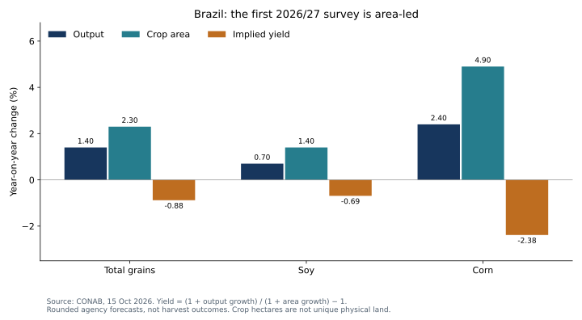

# Brazil agriculture: who captures productivity, and what happens to land?

**21 October 2026 · Public agency forecast decomposition and illustrative farm economics · Issuer/nature attribution: NEEDS_DATA.**

**Conclusion:** CONAB's first 2026/27 survey supports an area-led near-term production forecast, not a blanket yield-growth claim. A separate productivity scenario shows why higher physical output need not improve producer profit or spare habitat. Price response, extra costs and land-use incentives determine who captures the benefit.

## Public evidence and original result

[CONAB's 15 October 2026 first survey](https://www.gov.br/conab/pt-br/assuntos/noticias/primeiro-levantamento-da-safra-de-graos-2026-27-estima-producao-acima-de-367-milhoes-de-toneladas) forecasts total grains at 367.1 million tonnes on 85.4 million crop hectares: output +1.4% and area +2.3%. The implied yield change is approximately **−0.88%**. Soy's +0.7% output / +1.4% area implies **−0.69%**; corn's +2.4% / +4.9% implies **−2.38%**. These are calculations from rounded agency forecasts, not realized harvest outcomes.

Yield growth = (1 + output growth) / (1 + area growth) − 1. An additional accounting decomposition splits the multiplicative interaction equally between area and yield so their contributions sum to output growth. It is not causal attribution. Total-grain yield also reflects crop mix. [Source definitions](sources.json) · [Computed results](RESULTS.md).

The independently chosen current official vintage challenges a near-term productivity narrative. It does **not** disprove a multi-decade structural productivity thesis, for which a consistent historical crop/region panel is still needed. The accompanying research reading guided the analytical questions; no proprietary estimates or stock list are copied.

## Financial and nature transmission

The separate [farm model](model.py) assumes revenue of 100 per hectare, costs of 70, a 10% yield gain and 5 extra cost units. With unchanged price, profit rises from 30 to 35. With price down 5%, profit falls to 29.5; with price down 10%, it falls to 24. The unchanged-profit price threshold is **−4.55%**. Inputs are hypothetical and are not calibrated to Brazilian farm accounts.

At fixed production, a 10% yield gain reduces the arithmetic crop-area requirement by **9.09%**. That is not observed land sparing. More profitable production can encourage expansion; lower prices can stimulate consumption. Multiple cropping means crop hectares are not unique physical hectares, and neither series directly identifies forest conversion or biodiversity loss.

| Value-chain exposure | What to test next |
|---|---|
| Farm producers | Regional yields, sale prices, input costs, leases and working capital determine profit capture. |
| Seeds, crop inputs and equipment | Adoption, producer affordability, pricing and share of productivity value determine supplier earnings. |
| Storage and logistics | Throughput, congestion, capacity and contract tariffs determine whether volume growth earns a return. |
| Lenders and land-linked assets | Collateral, borrower economics, traceability and land rights determine credit and nature exposure. |

These are research routes, not verified issuer exposures or recommendations. **NEEDS_DATA:** municipality/crop time series; unique land polygons and verified conversion histories; biome and habitat condition; supplier/farm traceability; rights/tenure evidence; and issuer-specific margin/capital exposure. No carbon credit, deforestation reduction or biodiversity outcome is claimed.

## Contrary case and next observation

Realized yields could outperform the first survey while prices and costs remain favorable, supporting producer profits. Weather disruption or input inflation could reverse that. Next retain this vintage, compare later CONAB revisions and eventual harvest observations, then add independently verified geographic evidence before discussing avoided conversion. Publication and model checks do not grant workflow approval or establish independent human validation.

## Reproduce

From the root: `python examples/brazil-agriculture/model.py --check` (Python 3.10+, standard library, offline). To redraw the optional chart with Matplotlib installed: `python examples/render_public_case_charts.py`. `--write` on the model intentionally replaces generated results; preserve historical input vintages.
